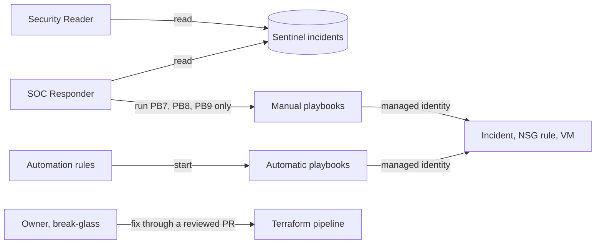

# project-Sentinel-SOC

Closed-loop SOC automation on Microsoft Sentinel. An Azure SSH honeypot feeds Sentinel; custom KQL rules raise incidents; Logic Apps playbooks do every response step, automatic or run by the analyst, so each action leaves evidence.

Status: Sentinel, the honeypot and the first playbooks are deployed through the pipeline.

## Layout

| Path | What it holds |
|---|---|
| `.github/workflows/terraform.yml` | The CI/CD pipeline |
| `providers.tf` | Terraform and provider versions, backend, Azure sign-in |
| `variables.tf` | Inputs and the region |
| `outputs.tf` | Key outputs |
| `sentinel.tf` | Log Analytics workspace, Sentinel, syslog data collection rule (DCR), Trusted_IPs watchlist, analytics rules with their KQL, the `SOARBlocks_CL` block log with its endpoint and DCR |
| `honeypot.tf` | VNet, NSG, public IP, Ubuntu 24.04 VM, Azure Monitor Agent, DCR link, first-boot script |
| `soar.tf` | Playbooks, their API connection and roles, automation rules |
| `governance/` | Control plane, applied by hand and outside the pipeline: policy exemption on `rg-lab-honeypot` for the intentionally open SSH port |
| `docs/` | Phase 0 checklist, SLA (P1–P4 overview, plus the P2 and P3 SLA files sent with notifications), triage reports, the attack-simulation runbook |

All Terraform is one root module with one state, so `terraform plan` shows what each change adds and Terraform works out the order itself. The honeypot is removed at the end by a PR that deletes `honeypot.tf` and its outputs.

## Deployment

Same CI/CD design as [project-IaC-Azconfig](https://github.com/hanqin-lyu/project-IaC-Azconfig), with the same subscription, OIDC identities and Azure Policy.

| Event | Identity | Steps |
|---|---|---|
| Pull request | CI (read-only) | `fmt -check`, `validate`, Checkov (SARIF to the Security tab), gitleaks, `plan` (shown in the job summary). The PR is merged only after CI passes |
| Push to `main` | CD (read-write) | A deployment request for the `production-demo` environment; after the owner approves it, `apply` |

CI runs on every pull request, and `Terraform Plan Preview` is a required check on `main`. Apply runs only when a merge changes a Terraform file. State is in an Azure storage account. One-time setup is in [docs/phase0-checklist.md](docs/phase0-checklist.md).

## Design notes

- **One Terraform root.** The first version had three stacks with separate state, which needed lookups between stacks and a job to work out which stack a change touched. One root and one state removes all of that; `terraform plan` already compares the code with what is deployed.
- **DCR and agent in code.** The syslog DCR and the Azure Monitor Agent are Terraform, not the Content hub "Syslog via AMA" connector, so every part of the deployment goes through the same reviewed pipeline.
- **Azure Verified Modules.** Resources use the official AVM modules where one exists, pinned to exact versions with telemetry off. Sentinel onboarding, the DCR link and the playbook's block rule are native `azurerm` resources.
- **Block rule outside the NSG module.** The `SOAR-Block-Attackers` rule is edited by the playbook, so Terraform creates it once and ignores its address list. A later apply never wipes real blocks.
- **Admin SSH rule outside the NSG module.** The rule uses the owner's IP, a sensitive value, and the module runs `for_each` over its rule map, which cannot hold one. A separate rule keeps the IP hidden in the plan.
- **Connection flushing stays off.** NSG changes do not end an established SSH session, which is why the manual Contain host playbook (Run Command) exists.
- **One rule per priority.** R2 (P1), R4 (P2), R5 (P3), R1 (P4). R3 (tool download from auditd) and R6 (low-risk volume email) from the early plan are dropped, and R5 is no longer closed automatically. auditd is still collected as command evidence.
- **Rules count by ingestion time, not event time.** Each rule runs every 10 minutes. Its "last 10 minutes" window filters on `ingestion_time()`, because a syslog burst reaches the workspace a minute or two after it happens; a `TimeGenerated` window would run before the rows arrive and then slide past them, so a short attack could be missed entirely (R5 missed its first test this way). R1 also widens `query_period` to `PT20M`, so late rows are still fed to the query; R2, R4 and R5 already query a full day. The 24-hour brute-force history still uses `TimeGenerated`, where a 90-second delay does not matter.
- **Every response step is a playbook.** Automatic playbooks do safe, reversible steps; disruptive steps are manual playbooks the analyst runs from the incident. Running a manual playbook replaces the Teams approval card from the early plan, and the run history records who did what and when. This is also least privilege: each playbook identity holds only the role its one job needs, and those assignments are Terraform. The human roles (Security Reader, SOC Responder, Owner) are a documented design, not assigned, because one person runs the lab. In the index each playbook is listed under the analytics rule it answers, with the automation rule that starts it.
- **Resource groups are made by hand.** Terraform looks up the three resource groups with data sources, so the CD identity needs no write access on the subscription. It has Contributor and Role Based Access Control Administrator on those three groups only, because playbook identities get roles in all three. Its OIDC credential also only works in the `production-demo` environment, after the owner approves the run.
- **Block log in a custom table.** PB5 writes each block, with its expiry, to `SOARBlocks_CL` through the Logs Ingestion API, and PB6 finds expired blocks with KQL. Incident comments were the other option, but they cannot be queried across incidents, and the table also feeds the workbook. The NSG rule is still what blocks. The DCR uses a separate data collection endpoint, because the AVM DCR module does not accept the `Direct` kind that would give the DCR its own endpoint. PB5 and PB6 call Azure with the HTTP action and their managed identity, so they need no extra API connection.
- **Honeypot findings in Checkov** are skipped inline with the reason "honeypot by design", never by turning the scan off.
- **One Checkov check is skipped in the pipeline: CKV_TF_1** (module source must be a git commit hash). AVM modules come from the Terraform Registry pinned to an exact version, and the modules nested inside AVM cannot be changed or skipped inline.

## Playbooks

Logic Apps playbooks and automation rules for Microsoft Sentinel, kept as Terraform in `soar.tf`. PB5, PB6, PB8 and PB9 and the automation rule AR-R2 are built; PB8 and PB9 are tested with a manual run on a test incident. The rest are planned.

### Rules

1. **Every response step is a playbook.** Each run leaves a run history and an incident comment, which is the evidence for the triage report.
2. **Least privilege.** Each playbook's managed identity holds only the role its one job needs, at the smallest scope (see [Identities](#identities)). People never change an incident, the NSG or the VM directly; they run a manual playbook. The human roles are a design only (see [Human roles](#human-roles)).
3. **Automation rules only start playbooks.** There is one automation rule per analytics rule. It starts that rule's automatic playbooks and changes nothing on the incident itself.
4. **Two kinds of playbook.** *Automatic* playbooks are started by an automation rule or a schedule and do only safe, reversible steps. *Manual* playbooks are run by the analyst from the incident page (Run playbook). Running one is the human decision, so disruptive steps such as ending a session are manual only.
5. **One job per playbook.**
6. **Settings are parameters.** Kill switch, block TTL and score threshold are workflow parameters, so behaviour changes without copying a playbook.
7. **Playbooks live in `soar.tf`.** Terraform deploys each one with the AVM module `Azure/avm-res-logic-workflow/azurerm`. Automation rules are native `azurerm` resources. API connections use `azapi`, because a managed identity connection needs `parameterValueType`, which `azurerm_api_connection` cannot set.
8. **No secrets in files.** Use managed identity, and Key Vault or an API connection for third-party keys.
9. **Templates are a starting point.** If a playbook starts from a Sentinel Content hub template (for example the Teams ones in SOAR Essentials), a comment in `soar.tf` names the template and what was changed.

### Index

| ID | Playbook | Class | Kind | Job |
|---|---|---|---|---|
| PB1 | Enrichment | Enrichment | Automatic | Look up the attacker IP and write the result as an incident comment |
| PB2 | Notify P2 | Orchestration | Automatic | Add the P2 tag, write the due time as a comment, send the Teams message with `docs/sla/P2-sla.md` attached |
| PB3 | Notify P3 | Orchestration | Automatic | Add the P3 tag, write the due time as a comment, send the Teams message with `docs/sla/P3-sla.md` attached |
| PB4 | Notify P1 | Response | Automatic | Add the P1 tag and send the Teams message |
| PB5 | Block IP | Response | Automatic | Add the attacker IP to the NSG block rule and log it with its expiry in `SOARBlocks_CL`; skip private, trusted and already-blocked IPs |
| PB6 | Block expiry | Response | Automatic (schedule) | Every hour, remove blocks past their expiry in `SOARBlocks_CL`, log the unblock and comment on the incident |
| PB7 | Contain host | Response | Manual | End the attacker's SSH session and lock the account through Run Command |
| PB8 | Report draft | Response | Manual | Post the incident facts as a comment to start the triage report |
| PB9 | Close incident | Response | Manual | Set the classification and write the closing reason as a comment |
| PB10 | Failure handler | Response | Automatic | When any playbook run fails, comment on the incident and send a Teams message |

### Response per analytics rule

#### R2 Compromise after brute force (P1)

| Step | Started by | Playbook |
|---|---|---|
| Incident created | Automation rule `AR-R2` | PB1 Enrichment, PB4 Notify P1, PB5 Block IP (PB5 only until PB1 and PB4 are built) |
| Block expiry reached | Schedule, every hour | PB6 Block expiry |
| Contain | Analyst | PB7 Contain host |
| Report and close | Analyst | PB8 Report draft, PB9 Close incident |

#### R4 Sudo probing (P2)

| Step | Started by | Playbook |
|---|---|---|
| Incident created | Automation rule `AR-R4` | PB1 Enrichment, PB2 Notify P2 |
| Contain, only if the user did more than probe | Analyst | PB7 Contain host |
| Report and close | Analyst | PB8 Report draft, PB9 Close incident |

#### R5 Sustained brute force (P3)

| Step | Started by | Playbook |
|---|---|---|
| Incident created | Automation rule `AR-R5` | PB1 Enrichment, PB3 Notify P3 |
| Close at the daily review | Analyst | PB9 Close incident |

#### R1 SSH brute force (P4)

Alert only, no incident, so there is no automation rule and no playbook. The alerts feed the Workbook.

PB10 Failure handler covers every playbook above.

### Identities

These role assignments are Terraform in `soar.tf`, so each one is in the plan and the diff.

| Identity | Role | Scope |
|---|---|---|
| PB1 Enrichment | Microsoft Sentinel Responder | `rg-soc-sentinel` |
| PB2, PB3, PB4 Notify | Microsoft Sentinel Responder (tag, comment). Teams through an API connection | `rg-soc-sentinel` |
| PB5 Block IP, PB6 Block expiry | Network Contributor | The `SOAR-Block-Attackers` rule only |
| | Monitoring Metrics Publisher (write to `SOARBlocks_CL`) | The `dcr-soar-blocks` DCR only |
| | Microsoft Sentinel Responder (comment; query Trusted_IPs and `SOARBlocks_CL`) | `rg-soc-sentinel` |
| PB7 Contain host | Virtual Machine Contributor | The honeypot VM only |
| | Microsoft Sentinel Responder | `rg-soc-sentinel` |
| PB8 Report draft, PB9 Close incident | Microsoft Sentinel Responder | `rg-soc-sentinel` |
| PB10 Failure handler | Logic App Operator (read the failed run) | `rg-core-automation` |
| | Microsoft Sentinel Responder | `rg-soc-sentinel` |
| Sentinel service account (Azure Security Insights) | Microsoft Sentinel Automation Contributor, so automation rules can start playbooks | `rg-core-automation` |

All are built-in roles limited by scope; there are no custom roles. Virtual Machine Contributor is wider than Run Command alone, but it reaches only the honeypot VM. The honeypot VM's own identity has no role.

### Human roles

Design only. The lab has one person, so a single owner account does all three jobs and these roles are not assigned.

| Role | Would have | Cannot |
|---|---|---|
| Security Reader | Microsoft Sentinel Reader | Change anything |
| SOC Responder | Microsoft Sentinel Reader; Microsoft Sentinel Playbook Operator on PB7, PB8, PB9 only | Run automatic playbooks; edit incidents, the NSG or the VM directly |
| Owner | Owner, used only to fix the lab when something breaks | |
